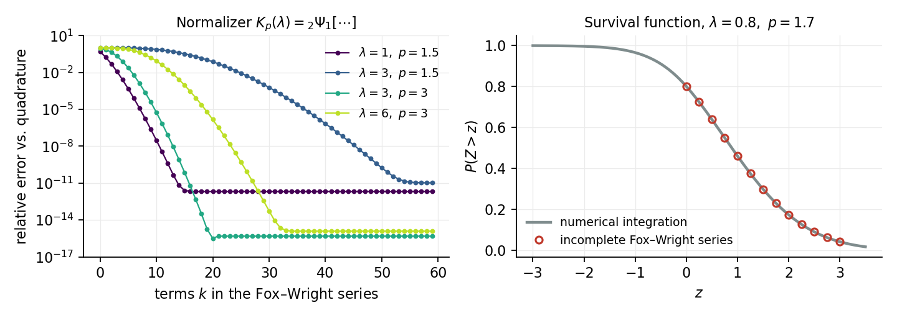
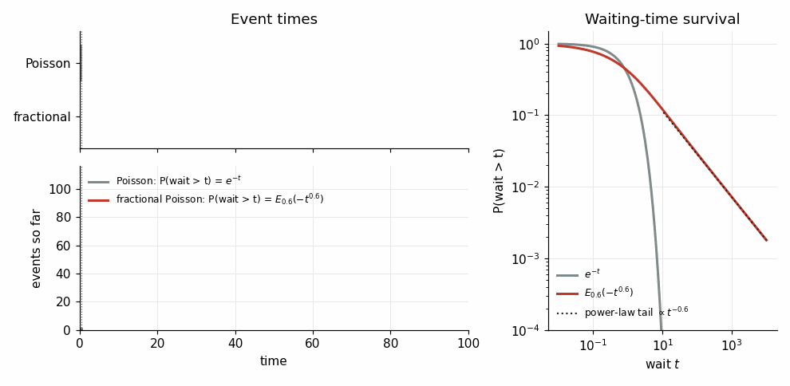
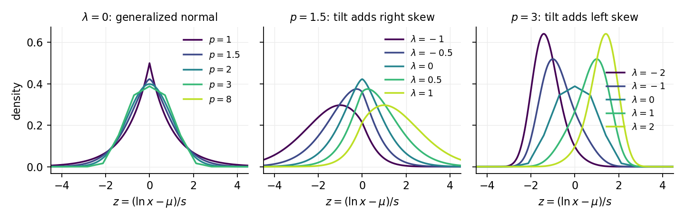
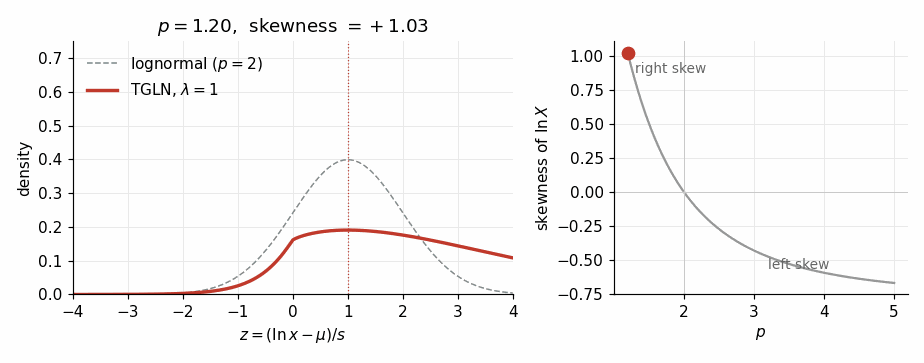
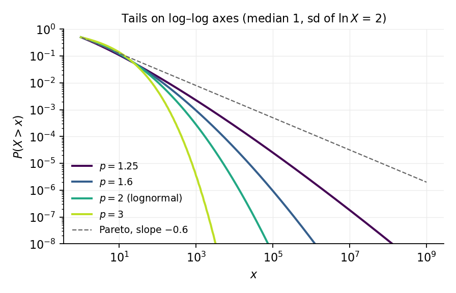
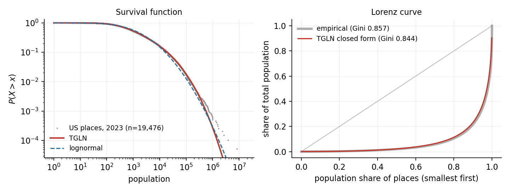

In [*Slowly Scaling Per-Record Differential Privacy*](https://arxiv.org/abs/2409.18118) we needed a noise distribution whose tails were heavier than Laplace or Gaussian. We ended up with the **exponential polylogarithmic (EPL)** distribution. The paper adds a shift and a truncation to the EPL and parameterizes it differently, all to make the privacy guarantee easy to state. Since this post is about the statistical properties of the broader family, I use a simpler form here.

In this form, the EPL density at $y\in\mathbb{R}$ is proportional to $\exp\{-|\ln|y|-\mu|^p/(p\sigma^p)\}$, where $\mu\in\mathbb{R}$ is a location and $\sigma>0$ a scale for $\ln|Y|$, and $p\ge 1$ is a shape parameter (with $\sigma<1$ when $p=1$, so that the density can be normalized). Writing down its normalizing constant and moments led to a family of special functions I had never used before: **incomplete Fox–Wright functions**.

Later I noticed that the EPL distribution, viewed on the log scale, is a constrained case of a simple and fairly natural distribution for positive, right-skewed data. This post is about that distribution and the special functions behind it.

## The tilted generalized normal

Start with the [generalized normal](https://en.wikipedia.org/wiki/Generalized_normal_distribution) density of order $p$, proportional to $e^{-|z|^p/p}$ for $z\in\mathbb{R}$. At $p=2$ it is the normal, at $p=1$ the Laplace, and as $p\to\infty$ it approaches the uniform on $[-1,1]$. Now [tilt it exponentially](https://en.wikipedia.org/wiki/Exponential_tilting), which means multiplying by $e^{\lambda z}$ for a real tilt parameter $\lambda$ and renormalizing:

$$
g_{p,\lambda}(z) = \frac{\exp\{\lambda z - |z|^p/p\}}{K_p(\lambda)}, \qquad z\in\mathbb{R},\ p>1.
$$

Let $Z$ be a random variable with this density. The denominator is the normalizing constant, the number that makes the density integrate to 1:

$$
K_p(\lambda) = \int_{-\infty}^{\infty} \exp\{\lambda z - |z|^p/p\}\,dz .
$$

For $p>1$ the term $|z|^p/p$ eventually outgrows the tilt $\lambda z$, so this integral is finite for every real $\lambda$. It has no elementary closed form except at $p=1$ and $p=2$. The ratio $K_p(\lambda)/K_p(0)$ is the moment generating function of the untilted ($\lambda=0$) density. That is why $K_p$ comes up again in the moments, the Lorenz curve and the CDF below.

What does tilting do? The factor $e^{\lambda z}$ gives more weight to large values of $z$ when $\lambda>0$ and to small values when $\lambda<0$, so the distribution shifts toward one side. It is also the gentlest way to do this: of all distributions with the new mean, the tilted one is the closest to the original. That is why tilting is a standard tool in probability, used for example in importance sampling.

## The normalizing constant is a Fox–Wright function

The part I enjoyed most was working out $K_p$. Expand $e^{\lambda z}$, integrate term by term (the odd terms vanish by symmetry), and you get

$$
K_p(\lambda) = \frac{2p^{1/p}}{p}\sum_{k\ge 0}\frac{\Gamma\!\left(\frac{2k+1}{p}\right)}{(2k)!}\left(p^{2/p}\lambda^2\right)^k .
$$

Here $\Gamma(a)=\int_0^\infty t^{a-1}e^{-t}\,dt$ is the gamma function. This series is a **Fox–Wright function**. The generalized hypergeometric function ${}_mF_n$ is built from ratios of Pochhammer symbols $(a)_k = a(a+1)\cdots(a+k-1) = \Gamma(a+k)/\Gamma(a)$, with $m$ of them on top and $n$ on the bottom. The Fox–Wright function ${}_m\Psi_n$ replaces them with gamma functions whose argument grows at a *non-unit rate*:

$$
{}_m\Psi_n\!\left[(a_i,A_i)_{i=1}^m;(b_j,B_j)_{j=1}^n;x\right] = \sum_{k\ge0}\frac{\prod_{i=1}^m\Gamma(a_i + A_i k)}{\prod_{j=1}^n\Gamma(b_j + B_j k)}\frac{x^k}{k!}.
$$

The $a_i$ and $b_j$ are the starting arguments of the gamma functions, and the rates $A_i, B_j>0$ say how fast each argument grows with $k$. When all the rates equal 1 this reduces (up to constants) to ${}_mF_n$. Writing $(2k)! = \Gamma(1+2k)$ and $1 = \Gamma(1+k)/k!$, the normalizer is

$$
K_p(\lambda) = \frac{2p^{1/p}}{p}\;{}_2\Psi_1\!\left[\left(\tfrac1p,\tfrac2p\right),(1,1);\,(1,2);\,p^{2/p}\lambda^2\right].
$$

The rate $2/p$ is what $|z|^p$ produces. Charles Fox (1928) and E. M. Wright (1935) studied these series to get asymptotic expansions for generalized hypergeometric functions. The series is entire when $\sum_j B_j - \sum_i A_i > -1$. In our case that is $2 - 2/p - 1 > -1$, which is exactly the condition $p>1$. So the region where the distribution exists for every tilt comes straight out of the convergence condition for the series.

The CDF is the **incomplete** version. Integrating from $z$ to $\infty$ instead of over the whole line turns each $\Gamma(\cdot)$ in the series into an upper incomplete gamma $\Gamma(\cdot, z^p/p)$, where $\Gamma(a,x)=\int_x^\infty t^{a-1}e^{-t}\,dt$. The odd terms no longer cancel, so the sum runs over all $k$:

$$
\Pr(Z>z) = \frac{1}{K_p(\lambda)}\sum_{k\ge0}\frac{\lambda^k}{k!}\,p^{\frac{k+1}{p}-1}\,\Gamma\!\left(\tfrac{k+1}{p},\tfrac{z^p}{p}\right), \qquad z\ge 0.
$$

Srivastava and coauthors developed this kind of incomplete Fox–Wright function (and the incomplete Fox $H$-function, a further generalization defined by a contour integral), mainly for fractional calculus. It was strange, in a good way, to find that machinery sitting inside the CDF of a distribution motivated by privacy noise.

The left panel shows the series converging to the quadrature value. A larger tilt, or $p$ closer to 1, needs more terms, since the terms grow before they shrink. In practice I evaluate $K_p$ by adaptive quadrature around the mode, because the integrand is log-concave and well behaved. The series is still what gives the theory: the entire-function property, the moment formula below and the exact $p=1$ and $p=2$ cases ($K_1 = 2/(1-\lambda^2)$ and $K_2 = \sqrt{2\pi}\,e^{\lambda^2/2}$).

### Where else Fox–Wright functions show up

Most of the literature on these functions comes from **fractional calculus and anomalous diffusion**:

- The **Wright function** $\phi(\alpha,\beta;z)=\sum_k z^k/(k!\,\Gamma(\alpha k+\beta))$, with $\alpha>-1$ and complex $\beta$ and $z$, is a ${}_0\Psi_1$. It gives the fundamental solution of the time-fractional diffusion equation. Its special case, the **Mainardi ($M$-Wright) function** $M_\nu(z)=\phi(-\nu,1-\nu;-z)$ with $0<\nu<1$, is itself a probability density on the half-line that interpolates between a Gaussian ($\nu=1/2$) and a delta function ($\nu\to1$).
- The **Mittag-Leffler function** $E_{\alpha,\beta}(z)=\sum_k z^k/\Gamma(\alpha k+\beta)$, with $\alpha>0$, is a ${}_1\Psi_1$ (take $(1,1)$ on top to cancel the $k!$). It replaces the exponential in fractional relaxation, viscoelasticity and fractional Poisson processes.
- **Stable distributions** have no closed-form density in general, but their densities can be written as Wright-type series or as Fox $H$-functions, which generalize Fox–Wright functions further.

The easiest of these to picture is waiting times. In a Poisson process, the chance of waiting longer than $t$ for the next event is $e^{-t}$. The **fractional Poisson process** replaces that exponential with the Mittag-Leffler function $E_\beta = E_{\beta,1}$ from the list above:

$$
\Pr(\text{wait} > t) = E_\beta(-t^\beta) = \sum_{k\ge0}\frac{(-t^\beta)^k}{\Gamma(\beta k + 1)}, \qquad 0<\beta\le 1.
$$

At $\beta=1$ this is just $e^{-t}$. For $\beta<1$ it starts out looking exponential, then switches to a power-law tail $t^{-\beta}/\Gamma(1-\beta)$, so very long waits are far more likely than under the Poisson model. The result is **bursty** activity: clusters of rapid events separated by long silences. The same pattern shows up in email and messaging activity, earthquake aftershocks and trades in financial markets. In the animation below both processes are driven by the same mechanism and differ only in the waiting-time distribution:

## The tilted generalized lognormal

Now move to the positive half-line. With $Z$ as above, if $\ln X = \mu + sZ$ with $\mu\in\mathbb{R}$ and $s>0$, then $X$ has what I've been calling the **tilted generalized lognormal (TGLN)** distribution. It has four parameters: location $\mu$, scale $s$, tilt $\lambda$ and shape $p$. Its density on $x>0$ is

$$
f(x) = \frac{1}{s x}\,g_{p,\lambda}\!\left(\frac{\ln x - \mu}{s}\right).
$$

Why tilt the generalized lognormal at all? Without a tilt, $\ln X$ is symmetric. Incomes, firm sizes and city populations are usually skewed even after taking logs, so the untilted family can't fit them. A tilt adds skewness with a single parameter and leaves the tail order alone. For $p>1$ the leading term of $-\ln\Pr(Z>z)$ is still $z^p/p$, and $\lambda$ only enters at lower order. This gives the parameters fairly separate jobs: $p$ sets how heavy the tails are and $\lambda$ sets the asymmetry. The tilt also acts on $\ln X$, so it is a power $x^{\lambda/s}$ in $x$. Power weights are exactly what moments and size-biasing apply, so both stay inside the family, as the properties below show. Other ways of skewing, such as two-piece or Azzalini-type constructions, don't have this closure.

It contains several familiar laws:

- $\lambda = 0$: [Vianelli's generalized lognormal](https://arxiv.org/abs/1301.1277);
- $p = 1$: the log-asymmetric-Laplace, or double Pareto, law (this needs $|\lambda|<1$ for the density to be normalizable);
- $p = 2$: the lognormal (the tilt just shifts the mean, so $Z\sim N(\lambda,1)$, a normal with mean $\lambda$ and variance 1);
- $\lambda = s$: the **EPL**.

The last case is the one that prompted this post. If $Y$ has the EPL density above, then $|Y|$ is TGLN with the same $\mu$ and $s=\lambda=\sigma$. The tilt $\lambda=s$ is special. Changing variables from $\ln x$ to $x$ brings in the factor $1/x=e^{-\mu}e^{-sz}$, and a tilt of $e^{sz}$ cancels it exactly. So the EPL is the TGLN whose density in $x$ is just the generalized normal kernel evaluated at $\ln x$, with no $1/x$ in front.

This is easier to see with the tilt measured relative to the scale, $a=\lambda/s$. Since $e^{\lambda z}\propto x^{\lambda/s}$, the TGLN density is

$$
f(x)\propto x^{a-1}\exp\{-|\ln x-\mu|^p/(p s^p)\},
$$

the same $x^{a-1}$ form as the generalized gamma. Vianelli's distribution is $a=0$ and the EPL is $a=1$. Multiplying by $x$ raises $a$ by one, so **the EPL is exactly the size-biased version of Vianelli's generalized lognormal** (more on size-biasing below). I keep $\lambda$ as the main parameter, because it keeps the standardized law $g_{p,\lambda}$ free of $s$.

The tilt behaves in a way I didn't expect. Its effect on the skewness of $Z$ (equivalently, of $\ln X$) depends on which side of 2 the shape parameter is. For $p<2$ a positive tilt gives right skew, and for $p>2$ it gives *left* skew. The sign of the skewness is the sign of $\lambda(2-p)$. As a result, the same amount of skewness can be produced in two ways, which leads to a likelihood for $p$ with two humps, one on each side of the lognormal.

Here is the flip in action. The tilt is fixed at $\lambda = 1$ while $p$ moves from 1.2 to 5. The density leans right while $p<2$, matches the lognormal (dashed) exactly at $p=2$, and then leans left:

## A few properties

**Moments are ratios of normalizers.** Because the tilt is exponential in $\ln X$, multiplying the density by $x^r$, for any real order $r$, just moves $\lambda$ to $\lambda + rs$:

$$
\mathbb{E}X^r = e^{r\mu}\,\frac{K_p(\lambda + rs)}{K_p(\lambda)}.
$$

For $p>1$, $K_p$ is entire (its power series in $\lambda$ converges for every $\lambda$), so moments of every real order (positive and negative) are finite.

**Size-biasing stays in the family.** The size-biased law, with density $x f(x)/\mathbb{E}X$, is again TGLN with the same $\mu$, $s$ and $p$ but tilt $\lambda+s$. Write $G_\lambda$ for the CDF of $g_{p,\lambda}$ and $Z_\lambda$ for a random variable with that distribution. The Lorenz curve $L(u)$, the share of the total held by the poorest fraction $u\in(0,1)$ of the population, is then $L(u) = G_{\lambda+s}(G_\lambda^{-1}(u))$. The Gini coefficient is $2\Pr(Z_{\lambda+s} > Z_\lambda) - 1$, with $Z_{\lambda+s}$ and $Z_\lambda$ independent. Neither depends on $\mu$. The GB2 (generalized beta of the second kind) and the double-Pareto-lognormal (dPlN) distributions share this property. The two-piece "skewed exponential power" families don't.

**Tails sit between lognormal and Pareto, or below lognormal.** The upper tail is log-Weibull, $-\ln \Pr(X>x) \sim (\ln x)^p/(p s^p)$. That is heavier than any Weibull tail and lighter than any power law, and the distribution is in the Gumbel domain of attraction. Moving $p$ from 1 toward 2 takes you from Pareto to lognormal, and $p>2$ goes lighter than lognormal.

### Connection to Zipf's law

The log–log plot above is the same picture as a **Zipf plot**. Zipf's law says that if you rank items by size, the $r$-th largest has size roughly proportional to $1/r$. Equivalently, $\Pr(X>x)\propto x^{-\alpha}$ with tail (Pareto) exponent $\alpha \approx 1$, so the plot is a straight line with slope $-1$. The discrete version is the **Zipf (or zeta) distribution** on the positive integers, $\Pr(K=k) = k^{-a}/\zeta(a)$ for $k=1,2,\dots$ and exponent $a>1$. Its normalizer is the Riemann zeta function $\zeta(a)=\sum_{k\ge1}k^{-a}$, so this is one more distribution defined by its special function.

Zipf's law is used and tested in many fields:

- **Language:** word frequencies in a corpus, Zipf's original example. The $r$-th most common word appears about $1/r$ as often as the most common one.
- **Cities and firms:** city populations in many countries (Gabaix showed that Gibrat's law of proportional growth plus a lower barrier produces it), and U.S. firm sizes (Axtell).
- **Computing:** web page and video requests, which is why caches and CDNs are sized with Zipf workloads in mind, and why a small fraction of keys gets most of the traffic.
- **Privacy:** when a few users or records contribute most of the data, worst-case sensitivity is set by the heaviest contributor. That kind of skew is part of what makes per-record privacy guarantees attractive.

The TGLN relates to Zipf through its *local* Pareto exponent $\alpha(x)$, minus the slope of the log–log survival curve at $x$. With $z = (\ln x - \mu)/s$ the standardized log size, for large $x$,

$$
\alpha(x) = -\frac{d\ln\Pr(X>x)}{d\ln x} \approx \frac{z^{p-1} - \lambda}{s}.
$$

At $p=1$ this is the constant $(1-\lambda)/s$, so the double Pareto case has an exact power-law tail and gives Zipf's law when $\lambda = 1-s$. For $p>1$ the slope increases slowly with $x$. The rank-size plot then looks Zipf-like over a range of sizes and bends downward at the very top. This fits a long debate about city sizes: Zipf's law describes the largest cities well, while Eeckhout found that the full distribution of all places looks closer to lognormal. In the TGLN, $p$ moves continuously between these two descriptions.

## Other distributions built on special functions

The TGLN isn't unusual in this respect. Many common distributions are defined by a special function, either as the normalizer or as the CDF. In the table, $\Gamma(a,x)$ is the upper incomplete gamma function defined above. $B_x(a,b)=\int_0^x t^{a-1}(1-t)^{b-1}\,dt$ is the incomplete beta function. $I_\nu$ and $K_\nu$ are the modified Bessel functions of the first and second kind with order $\nu$ ($K_\nu$ is unrelated to the normalizer $K_p$). $\kappa$ is the von Mises concentration and $Q$ is the Marcum $Q$-function. $\zeta(a,q)=\sum_{k\ge0}(k+q)^{-a}$ is the Hurwitz zeta function. In the Conway–Maxwell–Poisson row, $\lambda$ is a rate (not the tilt) and $\nu$ is a dispersion parameter.

| Distribution | Special function | Where it appears |
|---|---|---|
| Gamma, generalized gamma, Weibull-type | (incomplete) gamma $\Gamma(a,x)$ | normalizer and CDF |
| Beta, Student's $t$, $F$, GB2 | (incomplete) beta $B_x(a,b)$ | normalizer and CDF |
| Normal, lognormal, dPlN | error function / Mills ratio | CDF; dPlN density |
| von Mises (circular) | modified Bessel $I_0(\kappa)$ | normalizer |
| Variance-gamma, generalized hyperbolic, normal-inverse Gaussian | modified Bessel $K_\nu$ | density |
| Noncentral $\chi^2$ | Bessel $I_\nu$ / Marcum $Q$ | density / CDF |
| Mittag-Leffler distribution | Mittag-Leffler $E_\alpha$ | CDF $=1-E_\alpha(-x^\alpha)$ |
| Zipf / zeta, Zipf–Mandelbrot | Riemann zeta $\zeta(a)$ / Hurwitz zeta $\zeta(a,q)$ | normalizer |
| Conway–Maxwell–Poisson | the series $\sum_j \lambda^j/(j!)^\nu$ (no closed form) | normalizer |
| Stable laws | Fox $H$-function | density |
| TGLN / EPL | (incomplete) Fox–Wright $\Psi$ | normalizer / CDF |

A pattern runs through the table. A gamma function gives the normalizer, an incomplete gamma function gives the CDF, and replacing the exponent 1 with a general $p$, or adding a tilt, tends to move you up a ladder of generality: gamma → hypergeometric (the incomplete beta is a ${}_2F_1$) → Fox–Wright → Fox $H$. The **Conway–Maxwell–Poisson** row is the closest relative of the TGLN. Raising $j!$ to a power $\nu$ is the discrete counterpart of raising $|z|$ to a power $p$. In both cases one extra exponent turns a closed-form normalizer ($e^\lambda$, or $\sqrt{2\pi}e^{\lambda^2/2}$) into a series that has a closed form only at a few special values.

## A quick look at data

To check that this isn't only a mathematical curiosity, here is the fitted TGLN for the 2023 populations of all 19,476 U.S. incorporated places. Its Gini coefficient comes from the closed-form expression above, with no simulation.

The fitted shape (the maximum-likelihood estimate of $p$) is $\hat p \approx 2.7$ with a negative tilt. That combination gives right skew in $\log$ population with a log-scale bulk that is lighter-tailed than normal. The fitted Gini is 0.844, against 0.857 in the data. The very largest cities still sit above the curve, so the far tail is a bit heavier than this model allows.

The Zipf view makes that gap concrete. A rank-size regression on the 100 largest places (all above about 225,000 people) gives a slope of about 1.5. That is steeper than the classic $\alpha=1$, which is usually found for metropolitan areas rather than incorporated places. The fitted TGLN has local exponent $\alpha(x)$ equal to 1 near 40,000 people and rising to about 2.4 at one million, so it implies a slope of about 2.1 over the top 100. The model gets Zipf's law right in the middle of the distribution and bends away from it too early at the top.

## What I took away

The distribution itself is simple: take an exponential-power density and tilt it. What I learned most from was having to understand *why* its normalizing constant has the form it does. That meant learning how Fox–Wright functions generalize hypergeometric series, why convergence of the series and existence of the distribution are the same condition, and how the incomplete versions turn into CDFs. Before this project, "Fox–Wright" was a name I'd skimmed past in reference tables. Now I see the same family of functions in fractional diffusion, stable laws and count models.
